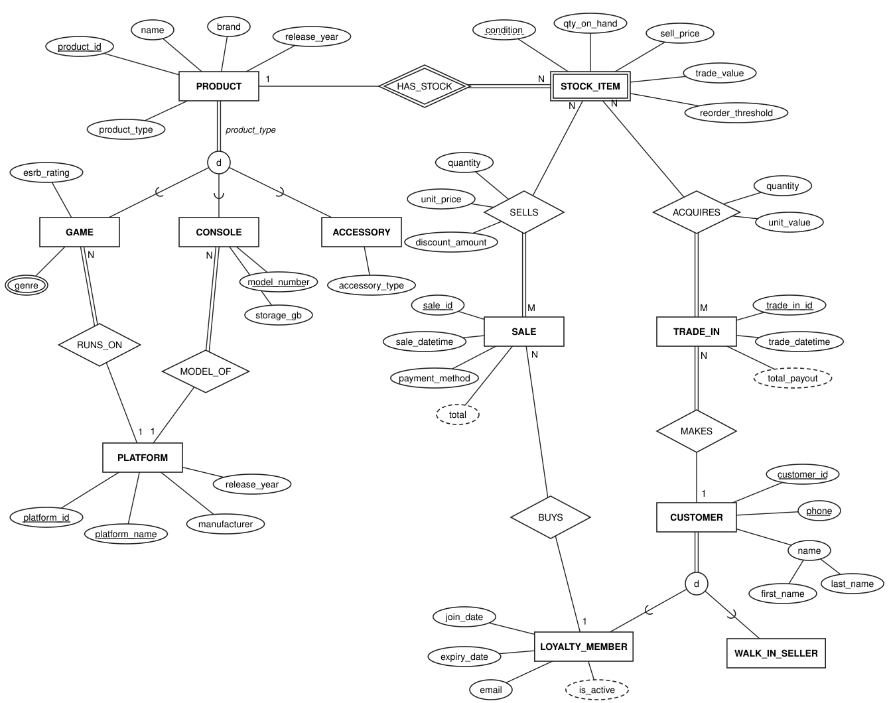
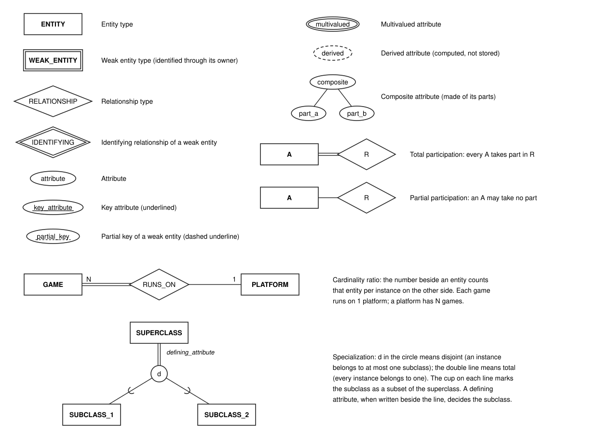

# EER Model

The Enhanced Entity-Relationship (EER) model is the conceptual design of the database: the things the store keeps data about, their attributes, how they relate, and the two specialization hierarchies. Every construct traces to a business rule in [01-requirements.md](01-requirements.md). The diagram uses Chen notation as presented by Elmasri and Navathe.

## Diagram

The diagram source is `diagrams/eer-model.drawio.svg`, which opens in draw.io; `diagrams/eer-model.png` is a 300 DPI export for printed documents.

## Notation

The same key is drawn as a figure in `diagrams/notation-key.drawio.svg`, with a 300 DPI export in `diagrams/notation-key.png`.

| Symbol                  | Meaning                                                   |
| ----------------------- | --------------------------------------------------------- |
| Rectangle               | Entity type                                               |
| Double rectangle        | Weak entity type (identified through its owner)           |
| Diamond                 | Relationship type                                         |
| Double diamond          | Identifying relationship of a weak entity                 |
| Oval                    | Attribute                                                 |
| Underlined name         | Key attribute                                             |
| Dashed underline        | Partial key of a weak entity                              |
| Double oval             | Multivalued attribute                                     |
| Dashed oval             | Derived attribute (computed, not stored)                  |
| Oval with its own ovals | Composite attribute                                       |
| Double line             | Total participation (every instance takes part)           |
| Single line             | Partial participation                                     |
| 1, N, M beside a line   | Cardinality ratio                                         |
| Circle with d           | Disjoint specialization                                   |
| Cup on a line           | Subset symbol: the subclass is a subset of the superclass |

Each cardinality number sits beside the entity it counts: `GAME —N— RUNS_ON —1— PLATFORM` reads "each game runs on 1 platform; a platform has N games."

## Entity Types

| Entity         | Kind                 | Key                        | Attributes                                                          | Rules               |
| -------------- | -------------------- | -------------------------- | ------------------------------------------------------------------- | ------------------- |
| PRODUCT        | Superclass           | product_id                 | name, brand, release_year, product_type                             | BR-01, BR-02        |
| GAME           | Subclass of PRODUCT  | (inherited)                | esrb_rating (optional), genre (multivalued)                         | BR-04, BR-05, BR-06 |
| CONSOLE        | Subclass of PRODUCT  | model_number (also unique) | storage_gb (optional)                                               | BR-07               |
| ACCESSORY      | Subclass of PRODUCT  | (inherited)                | accessory_type                                                      | BR-08               |
| PLATFORM       | Strong               | platform_id, platform_name | manufacturer, release_year                                          | BR-03               |
| STOCK_ITEM     | Weak (owner PRODUCT) | Partial key condition      | qty_on_hand, sell_price, trade_value (used only), reorder_threshold | BR-09 to BR-12      |
| CUSTOMER       | Superclass           | customer_id, phone         | name (first_name, last_name)                                        | BR-13 to BR-15      |
| LOYALTY_MEMBER | Subclass of CUSTOMER | (inherited)                | join_date, expiry_date, email (optional), is_active (derived)       | BR-16, BR-17        |
| WALK_IN_SELLER | Subclass of CUSTOMER | (inherited)                | None of its own                                                     | BR-15               |
| SALE           | Strong               | sale_id                    | sale_datetime, payment_method, total (derived)                      | BR-18, BR-20, BR-22 |
| TRADE_IN       | Strong               | trade_in_id                | trade_datetime, total_payout (derived)                              | BR-24, BR-26        |

## Relationship Types

| Relationship            | Between              | Ratio | Participation                      | Attributes                            | Rules                      |
| ----------------------- | -------------------- | ----- | ---------------------------------- | ------------------------------------- | -------------------------- |
| RUNS_ON                 | GAME, PLATFORM       | N:1   | GAME total, PLATFORM partial       | None                                  | BR-04                      |
| MODEL_OF                | CONSOLE, PLATFORM    | N:1   | CONSOLE total, PLATFORM partial    | None                                  | BR-07                      |
| HAS_STOCK (identifying) | PRODUCT, STOCK_ITEM  | 1:N   | STOCK_ITEM total, PRODUCT partial  | None                                  | BR-09                      |
| SELLS                   | SALE, STOCK_ITEM     | M:N   | SALE total, STOCK_ITEM partial     | quantity, unit_price, discount_amount | BR-18, BR-19, BR-21, BR-23 |
| ACQUIRES                | TRADE_IN, STOCK_ITEM | M:N   | TRADE_IN total, STOCK_ITEM partial | quantity, unit_value                  | BR-24 to BR-26             |
| BUYS                    | LOYALTY_MEMBER, SALE | 1:N   | Both partial                       | None                                  | BR-20                      |
| MAKES                   | CUSTOMER, TRADE_IN   | 1:N   | TRADE_IN total, CUSTOMER partial   | None                                  | BR-24                      |

## Specializations

| Superclass | Subclasses                     | Disjointness | Completeness | Defined by                | Rules |
| ---------- | ------------------------------ | ------------ | ------------ | ------------------------- | ----- |
| PRODUCT    | GAME, CONSOLE, ACCESSORY       | Disjoint     | Total        | Attribute product_type    | BR-01 |
| CUSTOMER   | LOYALTY_MEMBER, WALK_IN_SELLER | Disjoint     | Total        | Membership (user-defined) | BR-15 |

**PRODUCT** is attribute-defined: the value of `product_type` decides the subclass. Each kind of product has attributes the others lack (a game's rating and genres, a console's model number, an accessory's type), and only games run on a platform through RUNS_ON.

**CUSTOMER** has no defining attribute. A customer becomes a loyalty member by joining the program, and a walk-in seller who joins becomes a member while keeping the same customer record (BR-15). WALK_IN_SELLER has no attributes of its own; it exists to show that the specialization is total, so every recorded customer is one or the other.

## Design Decisions

**STOCK_ITEM is a weak entity.** A stock record has no identity apart from its product: "Used – Loose" means nothing until the product is known. Its partial key `condition` combined with its owner's key identifies it, through the identifying relationship HAS_STOCK. Counting stock per product and condition (BR-09), rather than recording each physical copy, matches how the store prices items and avoids serial numbers, which are out of scope.

**Sale and trade-in lines are relationship attributes.** The quantity and price of a line depend on both the sale and the stock record, so they belong to the M:N relationship SELLS rather than to either entity. ACQUIRES does the same for trade-ins. Each relationship becomes its own table in the relational schema.

**The price is recorded on the line.** `unit_price` on SELLS is not a copy of `sell_price` on STOCK_ITEM: it is the price charged at the time of the sale (BR-19). The same holds for `unit_value` on ACQUIRES and `trade_value` on STOCK_ITEM.

**Derived attributes are not stored.** A sale's total, a trade-in's total payout, and a member's active status can always be computed from other data, so they are drawn with dashed ovals and later computed in views.

**Customers who only buy are not recorded.** BUYS is partial on both sides: a sale without a member is an anonymous sale (BR-13, BR-20), and a member may never buy anything.

**Phone is a second key of CUSTOMER.** Each phone number belongs to one customer record (BR-14), so `phone` is a key alongside `customer_id`.

## Constraints Not Shown in the Diagram

An EER diagram cannot show value ranges, conditions that depend on other attributes, or how data changes over time. These rules are enforced later by `CHECK` constraints, triggers, views, or the application.

| Constraint                                                                          | Rule         |
| ----------------------------------------------------------------------------------- | ------------ |
| A game released before 1994 has no ESRB rating; later games have one                | BR-05        |
| Only used stock records have a trade-in value                                       | BR-11        |
| Quantity on hand is never negative                                                  | BR-12        |
| A membership's expiry date is one year after it starts or is renewed                | BR-16        |
| The member discount applies only to active members and never exceeds the line total | BR-21        |
| Selling lowers stock; trading in raises it                                          | BR-23, BR-26 |
| Trade-in lines name used stock records only                                         | BR-25        |
| What each role may see                                                              | BR-27        |

## Sources

- Elmasri, R., and Navathe, S. B. _Fundamentals of Database Systems_, 7th ed., Pearson, 2016: Chapter 3 (ER model) and Chapter 4 (EER model).
