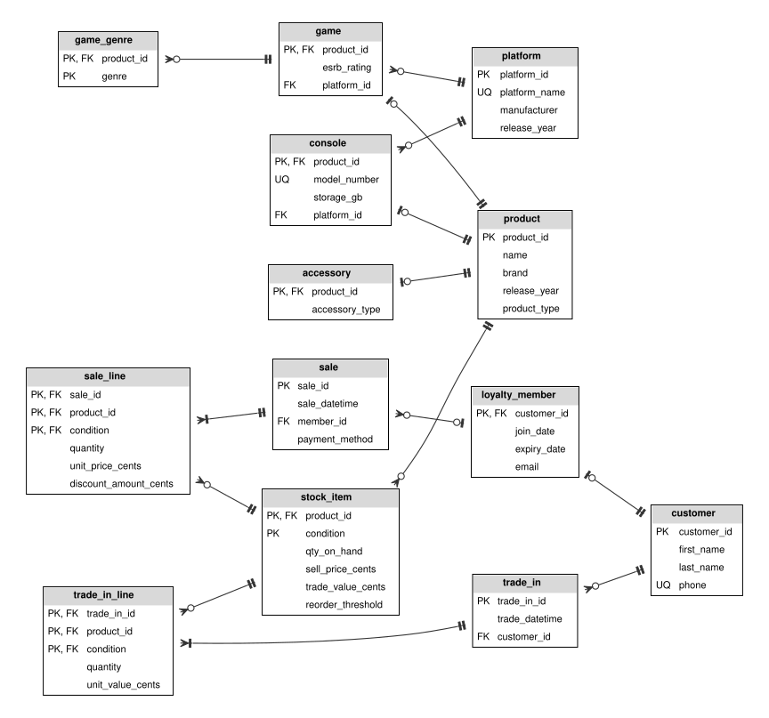
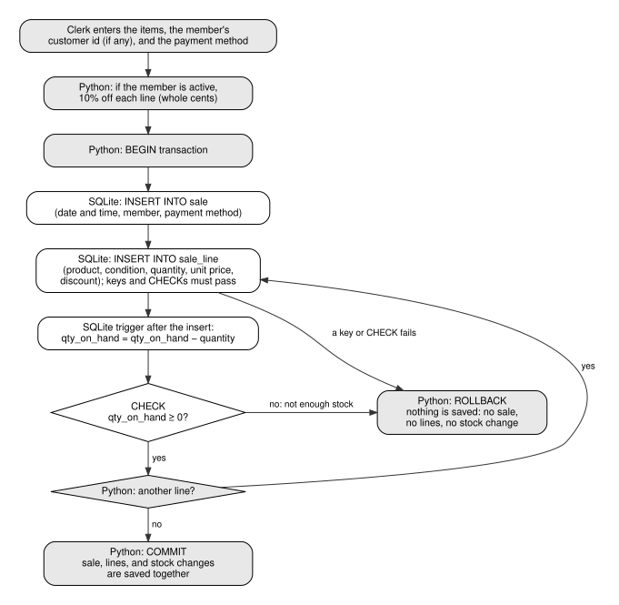

# Relational Schema

This document maps the [EER model](02-eer-model.md) to relations, describes their keys and columns, and shows that every relation is in Boyce-Codd normal form (BCNF). Business rule IDs refer to [01-requirements.md](01-requirements.md).

## Mapping the EER Model

The mapping follows the ER-to-relational mapping algorithm in Elmasri and Navathe, Chapter 9.

1. **Strong entity types** become relations: `platform`, `product`, `customer`, `sale`, and `trade_in`. The composite attribute `name` is stored as its parts, `first_name` and `last_name`. Derived attributes (a sale's total, a trade-in's total payout, a member's active status) are not stored.
2. **The weak entity type STOCK_ITEM** becomes `stock_item`. Its primary key is the owner's key plus the partial key: (`product_id`, `condition`). The identifying relationship HAS_STOCK needs no relation of its own.
3. **1:1 relationships:** none apart from the specializations.
4. **1:N relationships** become a foreign key on the N side: RUNS_ON → `game.platform_id`, MODEL_OF → `console.platform_id`, BUYS → `sale.member_id`, and MAKES → `trade_in.customer_id`. A foreign key is NOT NULL when the N side's participation is total and nullable when it is partial, so `sale.member_id` is the only nullable one.
5. **M:N relationships** become relations whose key combines both participants' keys: SELLS → `sale_line` and ACQUIRES → `trade_in_line`. The relationship's attributes (quantity, price or value, discount) become their columns.
6. **The multivalued attribute** `genre` becomes `game_genre`, keyed by (`product_id`, `genre`).
7. **N-ary relationships:** none.
8. **Specializations** use a superclass table plus one table per subclass (option 8A in Elmasri and Navathe). `game`, `console`, and `accessory` share their superclass's key, `product_id`, which is also a foreign key to `product`. For CUSTOMER, only LOYALTY_MEMBER becomes a table: WALK_IN_SELLER has no attributes or relationships of its own, so a customer with no `loyalty_member` row is a walk-in seller.

Keeping a `product` table lets `stock_item` reference any product with one foreign key, whatever its kind. The foreign key from `game_genre` to `game`, rather than to `product`, means only games can have genres.

## Relations

| Relation       | Columns                                                                                    | Primary key                          | Foreign keys                                                 | Unique        |
| -------------- | ------------------------------------------------------------------------------------------ | ------------------------------------ | ------------------------------------------------------------ | ------------- |
| platform       | platform_id, platform_name, manufacturer, release_year                                     | platform_id                          |                                                              | platform_name |
| product        | product_id, name, brand, release_year, product_type                                        | product_id                           |                                                              |               |
| game           | product_id, esrb_rating, platform_id                                                       | product_id                           | product_id → product; platform_id → platform                 |               |
| game_genre     | product_id, genre                                                                          | (product_id, genre)                  | product_id → game                                            |               |
| console        | product_id, model_number, storage_gb, platform_id                                          | product_id                           | product_id → product; platform_id → platform                 | model_number  |
| accessory      | product_id, accessory_type                                                                 | product_id                           | product_id → product                                         |               |
| stock_item     | product_id, condition, qty_on_hand, sell_price_cents, trade_value_cents, reorder_threshold | (product_id, condition)              | product_id → product                                         |               |
| customer       | customer_id, first_name, last_name, phone                                                  | customer_id                          |                                                              | phone         |
| loyalty_member | customer_id, join_date, expiry_date, email                                                 | customer_id                          | customer_id → customer                                       |               |
| sale           | sale_id, sale_datetime, member_id, payment_method                                          | sale_id                              | member_id → loyalty_member                                   |               |
| sale_line      | sale_id, product_id, condition, quantity, unit_price_cents, discount_amount_cents          | (sale_id, product_id, condition)     | sale_id → sale; (product_id, condition) → stock_item         |               |
| trade_in       | trade_in_id, trade_datetime, customer_id                                                   | trade_in_id                          | customer_id → customer                                       |               |
| trade_in_line  | trade_in_id, product_id, condition, quantity, unit_value_cents                             | (trade_in_id, product_id, condition) | trade_in_id → trade_in; (product_id, condition) → stock_item |               |

**Data types.** Identifiers, counts, and years are integers. Money is stored as an integer number of cents, and every money column ends in `_cents`, because binary floating point cannot represent most decimal amounts exactly. Dates are text in the form `YYYY-MM-DD` and date-times in the form `YYYY-MM-DD HH:MM:SS` (store-local time), which sort and compare correctly as text.

**Columns that allow NULL** (every other column is NOT NULL):

| Column                       | NULL means                                                            | Rule  |
| ---------------------------- | --------------------------------------------------------------------- | ----- |
| game.esrb_rating             | The game was released before the ESRB began rating games              | BR-05 |
| console.storage_gb           | The console has no built-in storage                                   | BR-07 |
| stock_item.trade_value_cents | The stock record is New; it is NULL exactly when the condition is new | BR-11 |
| loyalty_member.email         | The member gave no email address                                      | BR-16 |
| sale.member_id               | An anonymous sale, or a member who did not present a membership       | BR-20 |

**Columns with a fixed set of values:**

| Column                   | Allowed values                                 |
| ------------------------ | ---------------------------------------------- |
| product.product_type     | game, console, accessory                       |
| game.esrb_rating         | EC, E, K-A, E10+, T, M, AO                     |
| accessory.accessory_type | controller, cable, memory_card, headset, other |
| stock_item.condition     | new, used_complete, used_loose                 |
| sale.payment_method      | cash, card                                     |

## Diagram

The diagram uses crow's foot notation. Each line joins a foreign key to the table it references; the symbol at each end gives how many rows on that side match one row on the other: two bars for exactly one, a bar and a circle for zero or one, a crow's foot and a bar for one or more, and a crow's foot and a circle for zero or more. The source is `diagrams/relational-schema.dot` (Graphviz); `diagrams/relational-schema.png` is a 300 DPI export for printed documents.

## Normalization

A relation is in BCNF when, for every nontrivial functional dependency X → Y, X is a superkey. Functional dependencies come from the business rules, not from sample data.

### Second normal form: the sale's date and time

Suppose each sale line also recorded when the sale happened:

`sale_line_wide(sale_id, product_id, condition, quantity, unit_price_cents, discount_amount_cents, sale_datetime, payment_method)`

The key is (`sale_id`, `product_id`, `condition`), but `sale_id → sale_datetime, payment_method` depends on only part of it. That partial dependency violates 2NF: a sale with three lines stores its date, time, and payment method three times, and changing one copy leaves the others wrong. Moving those columns into `sale`, keyed by `sale_id` alone, removes the repetition. The decomposition is lossless because the shared attribute, `sale_id`, is the key of `sale`.

### Third normal form: the platform's name

Suppose each game recorded its platform's name and manufacturer:

`game_wide(product_id, esrb_rating, platform_id, platform_name, manufacturer)`

Here `product_id → platform_id` and `platform_id → platform_name, manufacturer`, so the platform's details depend on the key only through `platform_id`. That transitive dependency violates 3NF: every PlayStation 4 game would repeat "PlayStation 4" and "Sony", and a platform with no games could not be recorded at all. Moving those columns to `platform` and keeping only the foreign key `platform_id` in `game` removes the problem.

### Consoles and model numbers

BR-07 makes each console product one hardware model, identified by its model number. That makes `model_number` a candidate key of `console`, so `model_number → storage_gb, platform_id` has a superkey on its left and `console` is in BCNF. If several products could share a model number (for example, bundles of the same hardware), `model_number` would no longer be a key, that dependency would be transitive, and the model's details would have to move to a separate relation.

### Membership dates

`expiry_date` is stored alongside `join_date` because neither determines the other: a renewal moves the expiry date forward a year (BR-16). If every membership lasted exactly one year from the join date with no renewals, `join_date → expiry_date` would hold and the expiry date would be redundant.

### BCNF check for every relation

| Relation       | Candidate keys                       | Nontrivial functional dependencies                                                                               | BCNF |
| -------------- | ------------------------------------ | ---------------------------------------------------------------------------------------------------------------- | ---- |
| platform       | platform_id; platform_name           | platform_id → platform_name, manufacturer, release_year; platform_name → platform_id, manufacturer, release_year | Yes  |
| product        | product_id                           | product_id → name, brand, release_year, product_type                                                             | Yes  |
| game           | product_id                           | product_id → esrb_rating, platform_id                                                                            | Yes  |
| game_genre     | (product_id, genre)                  | None (all-key relation)                                                                                          | Yes  |
| console        | product_id; model_number             | product_id → model_number, storage_gb, platform_id; model_number → product_id, storage_gb, platform_id           | Yes  |
| accessory      | product_id                           | product_id → accessory_type                                                                                      | Yes  |
| stock_item     | (product_id, condition)              | (product_id, condition) → qty_on_hand, sell_price_cents, trade_value_cents, reorder_threshold                    | Yes  |
| customer       | customer_id; phone                   | customer_id → first_name, last_name, phone; phone → customer_id, first_name, last_name                           | Yes  |
| loyalty_member | customer_id                          | customer_id → join_date, expiry_date, email                                                                      | Yes  |
| sale           | sale_id                              | sale_id → sale_datetime, member_id, payment_method                                                               | Yes  |
| sale_line      | (sale_id, product_id, condition)     | (sale_id, product_id, condition) → quantity, unit_price_cents, discount_amount_cents                             | Yes  |
| trade_in       | trade_in_id                          | trade_in_id → trade_datetime, customer_id                                                                        | Yes  |
| trade_in_line  | (trade_in_id, product_id, condition) | (trade_in_id, product_id, condition) → quantity, unit_value_cents                                                | Yes  |

Every determinant is a candidate key, so all 13 relations are in BCNF.

### Dependencies that do not hold

Knowing which dependencies are false matters as much as knowing the true ones, because a false dependency would justify a wrong decomposition or a wrong key.

| Dependency that does not hold              | Why                                                                                                                  |
| ------------------------------------------ | -------------------------------------------------------------------------------------------------------------------- |
| name → product_id                          | The same title released for two platforms is two products (BR-04)                                                    |
| (product_id, condition) → unit_price_cents | Selling prices change; a line keeps the price charged at the time (BR-19)                                            |
| join_date → expiry_date                    | A renewal moves the expiry date forward, so two members who joined the same day can expire on different days (BR-16) |
| (first_name, last_name) → customer_id      | Two customers can share a name; the phone number tells them apart (BR-14)                                            |

## Where Each Rule Is Enforced

A rule is enforced in the strongest place that can hold it: a key or NOT NULL, then a `CHECK` on one row, then a trigger for rules that span rows or tables, then a view or the application.

| Rule                                             | Enforced by                                                                                        |
| ------------------------------------------------ | -------------------------------------------------------------------------------------------------- |
| BR-01 every product is exactly one kind          | CHECK on product_type; a trigger checks that the subclass row matches product_type                 |
| BR-03 platform names are unique                  | UNIQUE (platform_name)                                                                             |
| BR-04 a game runs on one platform                | game.platform_id NOT NULL, foreign key                                                             |
| BR-05 ESRB rating                                | CHECK on allowed values; the pre-1994 exception is left to data entry                              |
| BR-07 one console product per model              | UNIQUE (model_number)                                                                              |
| BR-09 one stock record per product and condition | Primary key (product_id, condition)                                                                |
| BR-11 trade-in value only for used stock         | CHECK: condition is new exactly when trade_value_cents is NULL                                     |
| BR-12 stock is never negative                    | CHECK (qty_on_hand >= 0)                                                                           |
| BR-14 one customer per phone number              | UNIQUE (phone)                                                                                     |
| BR-15 member or walk-in seller, never both       | By construction: a member has a loyalty_member row, a walk-in seller does not                      |
| BR-16 membership dates                           | CHECK (expiry_date > join_date); the one-year length is set by the application                     |
| BR-17 active membership                          | Computed in a view                                                                                 |
| BR-18, BR-24 at least one line                   | The application inserts a sale or trade-in and its lines in one transaction                        |
| BR-19 price recorded on the line                 | unit_price_cents is stored on sale_line                                                            |
| BR-21 member discount                            | CHECK (discount ≤ quantity × unit price); the 10% for active members is applied by the application |
| BR-22 one payment method                         | CHECK on payment_method                                                                            |
| BR-23 a sale lowers stock                        | Trigger on sale_line insert                                                                        |
| BR-25 trade-ins take used items only             | CHECK (condition <> 'new') on trade_in_line                                                        |
| BR-26 a trade-in raises stock                    | Trigger on trade_in_line insert                                                                    |
| BR-27 what each role sees                        | One view per role                                                                                  |

A `stock_item` row must exist before a sale or trade-in can name it, because both line tables reference it with a foreign key.

## Recording a Sale

A sale shows how the application, the constraints, and a trigger work together. The application works out each line's discount, then inserts the sale and its lines in one transaction. Each line must pass its keys and `CHECK` constraints; a trigger then lowers the stock on hand, and the `CHECK (qty_on_hand >= 0)` on `stock_item` rejects the line if that would leave fewer than zero units. Any error rolls back the whole transaction, so a sale is saved with all its lines and stock changes or not at all. A trade-in follows the same steps, except that its trigger raises the stock instead.

Shaded steps run in the application (Python); white steps run in the database (SQLite). The source is `diagrams/sale-flow.dot` (Graphviz); `diagrams/sale-flow.png` is a 300 DPI export.

## Sources

- Elmasri, R., and Navathe, S. B. _Fundamentals of Database Systems_, 7th ed., Pearson, 2016: Chapter 9 (ER-to-relational mapping), Chapter 14 (functional dependencies and normal forms), and Chapter 15 (decomposition properties).
- [Graphviz: arrow shapes](https://graphviz.org/doc/info/arrows.html)
